# GUI tutorial: two solar cells

*Created with Claude Opus 5 (Anthropic), 2026-08-17.*

This tutorial builds two complete devices in the Simudo GUI, runs them, and
looks at the results. It is a guided path rather than a manual: every panel is
described where you first need it, and there is a short reference at the end.

You will build:

1. **A silicon p-n diode** — in the dark first, then under AM1.5 illumination,
   and finally a run that stops at a checkpoint and resumes.
2. **An intermediate-band solar cell with a heterojunction** — p-Al₀.₃Ga₀.₇As |
   IB | n-GaAs, illuminated.

## Starting the GUI

For most users, the GUI runs on your own machine and submits the actual
simulation elsewhere — to a Docker container or over SSH — so you do not need
FEniCS locally, only the GUI's own dependencies. The
[installation instructions](install.rst) cover this in full; in brief, you
want to make an environment with the GUI's dependencies:

```bash
conda create -n simudo_gui python=3.11 \
  panel param numpy scipy matplotlib bokeh pyyaml -c conda-forge
conda activate simudo_gui
```

and then install Simudo itself **without its dependencies**, since you want the
GUI code only rather than the solver:

```bash
pip install --no-deps simudo
```

Then start the GUI, from whatever directory you keep your project files in:

```bash
cd ~/my-simudo-projects        # wherever you want your project files to live
python -m simudo.gui --show --port 5006
```

Launch it from your own project directory rather than anywhere else: the GUI's
Open and Save dialogs start in the directory you launched from.

To open a particular project at startup, give the path to its yaml file as an
argument:

```bash
python -m simudo.gui my_device.yaml --show --port 5006
```

Without one, the GUI reopens your most recent project — or, on a first run, the
bundled example. Any other arguments are passed on to `panel serve`, so its
options (`--port`, `--address`, and so on) work as usual.

The GUI should open in your web browser.

If it stops with `ModuleNotFoundError: No module named 'simudo'`, then Simudo
is not importable from the active environment — most often the `pip install
--no-deps simudo` step above went into a different environment from the one
that is now activated.

> **Note:** Working from a development clone rather than a pip install? Make the
> clone importable first. From its top directory:
>
> ```bash
> pip install -e . --no-deps
> ```
>
> then launch as above.

---

## Part 1 — A silicon p-n diode

### 1.1 Layers and materials

Simudo in general can treat 2D devices, but the GUI is designed for 1D
structures.

In the GUI, a device is a stack of **layers**. Each layer has physical
properties: thickness and material parameters, and a mesh specification. The
physical properties of a layer can be specified with material files or given
manually, which we will show below.

A new project starts with an empty stack:

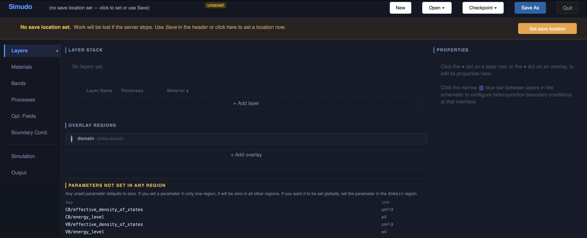

Choose a save location for your project using the `Set save location` button at
the top. Then add two layers with **+ Add layer**, and set their names and
thicknesses. Leave the Material column alone for now — the project has no
materials in it yet, so there is nothing to choose:

| Layer | Thickness |
|---|---|
| `p` | 1 µm |
| `n` | 99 µm |

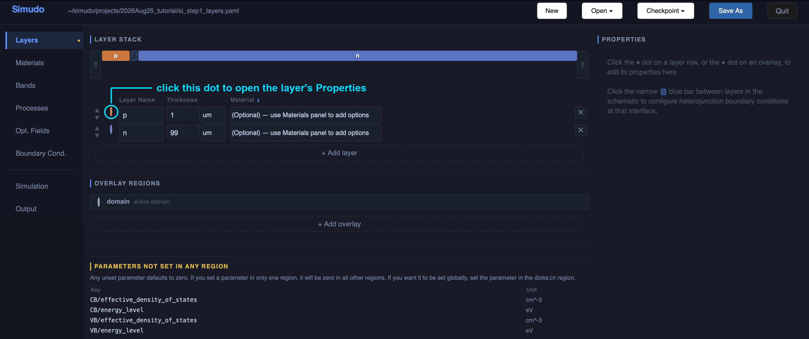

Next, the doping. Click the coloured dot at the left of a layer row — circled
above — to open that layer's **Properties** on the right. Under **DOPING**,
pick **n-type** or **p-type** and type the **Concentration** as a positive
number. You never type a sign:

| Layer | Type | Concentration |
|---|---|---|
| `p` | p-type | 1e17 cm⁻³ |
| `n` | n-type | 1e17 cm⁻³ |

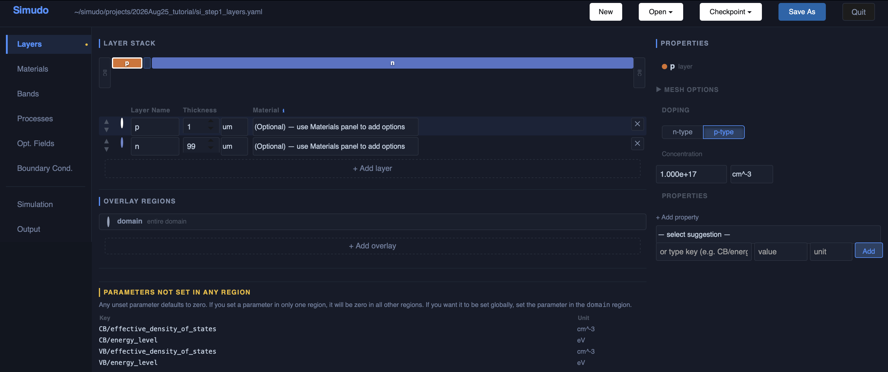

Underneath, the GUI stores this as the single signed charge density Simudo
actually solves with, `poisson/static_rho` — negative for acceptors, positive
for donors. That is the name you will see in the saved project file, and in the
"parameters not set in any region" list.

Now give the layers a material. Go to the **Materials** panel, find
`SiliconMaterial` in the library and click **Add to project**. A library
material supplies band gap, effective masses, mobilities, thermal velocities,
SRH lifetimes, permittivity — and, for silicon, a measured absorption spectrum
that §1.5 will use.


Return to the **Layers** panel and set the Material column of both layers to
`Silicon`, which is now offered in the dropdown:

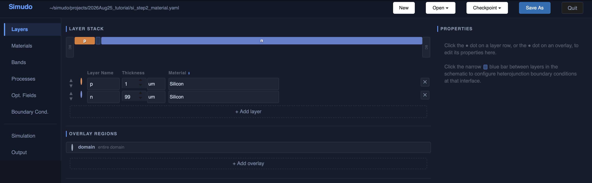

Compare this with the two-layer figure above. There, a **parameters not set in
any region** panel listed four band parameters — `CB/energy_level`,
`VB/energy_level` and the two effective densities of states. All four came with
the material, so the panel has nothing left to report and disappears.

One parameter was there from the start and is worth knowing about:
`temperature`, on the `domain` overlay, at 300 K. No material supplies it — it
is a property of the experiment rather than of silicon — so a new project
starts with the default. Click the dot on the `domain` row under **Overlay
regions** to see it, and change it there if you are not working at room
temperature.

> **Warning:** Take the "parameters not set in any region" list seriously. An
> unset parameter does not fall back to something sensible; it is **zero**, and
> a zero mobility or a zero density of states will fail in the solver rather
> than at the point where you forgot it. The list is the GUI telling you what
> the run is missing, before you spend the time on it.

> **Note:** Any property you set manually on the Layers panel **overrides** the
> material's value, because material rules have the lowest priority. So you can
> load in a material and manually override any parameters you want to change,
> without changing the material file.

### 1.2 Bands

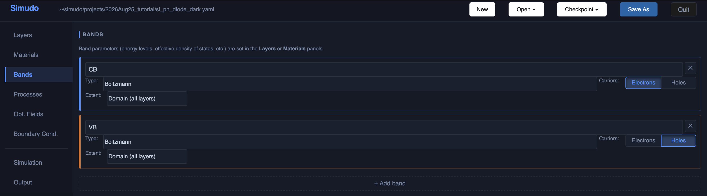

A silicon diode needs the two ordinary bands. Both are `Boltzmann` bands, which
is the right choice unless you are working at degeneracy:

| Band | Type | Carriers | Extent |
|---|---|---|---|
| `CB` | Boltzmann | Electrons | Domain (all layers) |
| `VB` | Boltzmann | Holes | Domain (all layers) |

**Carriers** is an Electrons/Holes toggle, not a number: it says which sign of
charge the band carries, and the GUI turns that into the −1 or +1 you would see
in the saved project file. **Extent** says where the band exists; *Domain (all
layers)* is the whole device. Part 2 uses a band that exists in only one layer.

### 1.3 Recombination

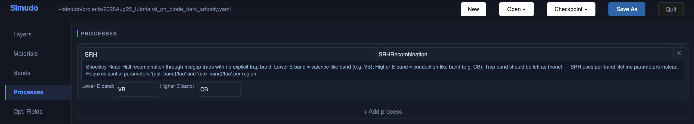

Processes move carriers between bands. For a dark diode you need one:
**`SRHRecombination`**, Shockley–Read–Hall recombination through midgap traps.

| Field | Value |
|---|---|
| Name | `SRH` |
| Class | `SRHRecombination` |
| Lower E band | `VB` |
| Higher E band | `CB` |

Simudo names the two bands of a transition by energy: the **lower** energy one
is the source band, the **higher** energy one the destination (with source and
destination so-named for modeling the associate generation process).

The silicon material already supplies `SRH/CB/tau` and `SRH/VB/tau` (1 ms) and
the trap energy level, so this device would run as it stands. We will override
the lifetimes anyway, because setting parameters may be something you will do
frequently, and this is the clearest place to learn it.

Go back to the **Layers** panel and click the dot on the `domain` row under
**Overlay regions**. The Properties pane opens on the right. In the **Add
property** box, choose `SRH/CB/tau`, type `1e-6` with unit `s`, and click
**Add**. Repeat for `SRH/VB/tau`. Both bands now have a 1 µs lifetime
everywhere in the device.

Now set a *different* lifetime in one layer. Click the dot on the `p` layer
row, add `SRH/CB/tau` there, and give it `5e-6 s`. The p region now has a 5 µs
electron lifetime while the rest of the device keeps 1 µs:

**A parameter set on a layer beats the same parameter set on `domain`.** The
priority order is named overlay region > layer > `domain` > material, so the
more specific statement about a region wins. That is the mechanism you use to
give one layer different properties from its neighbours. Note where `domain`
sits: it is the *device-wide default*, so a layer overrides it, while a named
overlay region — the kind you will build in [§2.1](#21-overlay-regions) —
overrides everything.

> **Note:** The 5 µs override on the `p` layer barely moves this device's
> answer — Jsc changes in the fourth decimal place. The p layer is 1 µm thick
> and the electron diffusion length there is tens of microns, so almost every
> carrier reaches the junction whatever the lifetime. It is here to show the
> mechanism. The lifetime that *does* matter for this cell is the one in the 99
> µm base — see [Absorbing is not collecting](#absorbing-is-not-collecting).

> **Warning:** A parameter you set in one region is **not** set everywhere.
> Unset parameters default to zero in the regions you did not set them in, and
> the Layer panel's "unset parameters" list stops warning you as soon as the
> parameter is set *somewhere*. Set parameters on `domain` when you mean them
> to apply device-wide.

### 1.4 Contacts, and the first run

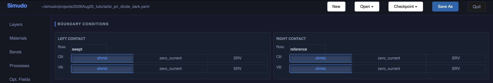

Go to the **Boundary Cond.** panel. By default, both contacts are **ohmic** on
both bands. One contact is `swept` (the voltage is applied there) and the other
is the `reference`. You can instead make zero current or surface-recombination
velocity (SRV) boundary conditions for each band at each contact.

In the **Simulation** panel, choose "Dark J-V" for the mode and list the
voltages 0 to 0.6 V in 0.1 V steps. You can use the `linspace` generator to
help make the voltage points; in this case, choose 7 points from 0 to 0.6 and
click "Apply." You can choose whether to save a checkpoint (from which you can
restart the simulation) at the end of the voltage sweep.

**Set the maximum mesh spacing before you run.** It is the `Max mesh spacing`
box in the same panel, and it defaults to **0.02 µm** — sensible for a
micron-scale cell, far too fine for this one. Left alone it puts about 5000
points into a 100 µm device and the run drags on for many minutes. Set it to
**1 µm**: the mesh becomes 174 points and the run takes about fifteen seconds.
Each layer also has its own starting spacing and expansion factor, on the
Layers panel; the defaults (0.005 µm, growing by 1.2×) keep the mesh fine at
the junction and at the contacts, which is where it needs to be, and the
maximum spacing caps how coarse it is allowed to get in between.

1 µm is not a compromise here. Refining this device from 129 points to 476
changes every point of the J–V curve by less than 0.01 %, and even the most
delicate quantity in §1.5 — the near-cancellation of generation against
recombination in the middle of the base — moves by about 1 %.


By default, XDMF output will be produced. If you want to make spatial plots in
the GUI, this option is required. You can also choose to get csv outputs of all
spatial quantities.

The **execution profile** at the bottom of that panel is where you say *where*
the simulation runs — a local process, a Docker container, or a machine over
SSH. Set that up (see the [installation instructions](install.rst)) and choose
"Set as Default" to avoid needing to do so again. Then press **▶ Run
Simulation** and watch the log.

This device takes about fifteen seconds on an M2 Mac Mini once the JIT cache is
warm; the log scrolls as each bias point converges. The very first run of your
life will be slower, because FEniCS compiles the forms.

#### What you should get

Open the **Output** panel. It already points at the run that just finished, and
the J–V curve is drawn; switch the scale to **Log|J|** to see the exponential
over several decades. Use **📁 Browse…** and **↻ Refresh** when you want to look
at an earlier run instead.

The dark diode gives a textbook exponential:

| V (V) | J (mA/cm²) |
|---|---|
| 0.0 | −1.7e−19 |
| 0.2 | 1.8e−4 |
| 0.4 | 0.34 |
| 0.6 | 738 |

The current rises by a factor of about 46.5 per 100 mV. Since n =
(q/kT)·dV/d(ln J), that is an **ideality factor of 1.008** — an almost
perfectly ideal diode, which is what this device should be.

### 1.5 Turning the light on

To study this device under illumination, we need to make the material absorb
light and add the light itself.

**The absorber.** Back on the **Processes** panel, add a second process:

| Field | Value |
|---|---|
| Name | `opt_cv` |
| Class | `BeerLambert` |
| Lower E band | `VB` |
| Higher E band | `CB` |

> **Note:** Name it exactly `opt_cv`. A material supplies its absorption
> coefficient under a key that includes the process name —
> `opt_cv/alpha_function` — so a process with a different name will not find
> silicon's absorption data. If the absorption coefficient is missing you get a
> warning in the log and a device that generates nothing.

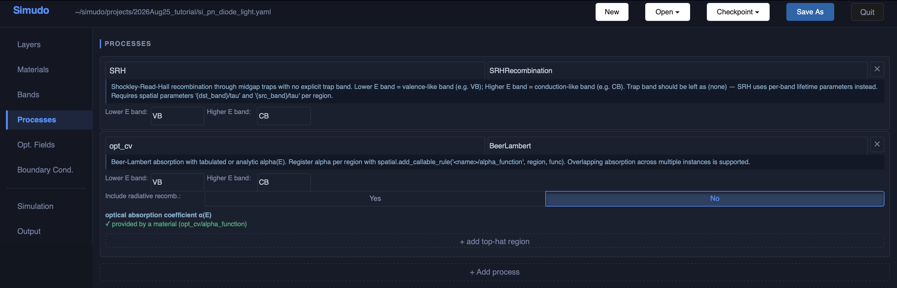

Silicon's measured α(E) (M. A. Green, 2008) comes from the material file, so
there is nothing to enter in the `optical absorption coefficient` section — the
panel says so, in green: *✓ provided by a material (opt_cv/alpha_function)*. If
you want an artificial absorption instead, you can add a top-hat in the process
card. A top-hat absorption is an energy-independent absorption coefficient
between cutoff energies E_min and E_max. If you add one, it sits on one or more
layers, and layer rules outrank material rules, so it will override the α(E)
from the material file.

**One more parameter.** Adding an optical process makes `refractive_index`
required, and the **Layers** panel will now list it among the missing
parameters. `BeerLambert` includes spontaneous emission by default, and the
Shockley–van Roosbroeck term that models it needs the material's refractive
index. Set `refractive_index` on the `domain` region to **3.5**. Without it the
run stops before solving, with a message naming the process that wanted it.
§2.5 explains what this emission term does, and when it is worth turning off.

**The light.** In **Opt. Fields**, add a field set:

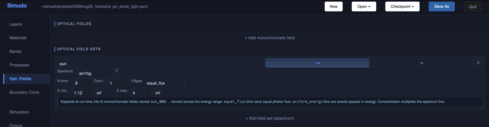

| Field | Value |
|---|---|
| Name prefix | `sun` |
| Direction | `+x` |
| Bins | 6 |
| E min / E max | 1.12 eV / 4.0 eV |
| Spectrum | `am15g` |
| Concentration | 1.0 |

Simudo divides the spectrum into bins of equal photon flux and solves
Beer–Lambert propagation for each. There is no point including photons below
the lowest energy your device can absorb — silicon's gap is 1.12 eV.

Finally, in **Simulation**, change the Mode to Illuminated J-V. The optical
ramp walks the illumination up from zero to full intensity before sweeping
voltage.

Add a few voltages while you are there. Under illumination the interesting part
of the curve is the knee near open circuit, and 0.1 V steps step straight over
it: the current is −7.8 mA/cm² at 0.5 V and +714 at 0.6 V, so the fill factor
comes out of thin air. Use `0, 0.1, 0.2, 0.3, 0.4, 0.45, 0.5, 0.55, 0.6`.
Keeping 0.6 V is worth it as a check on the whole calculation — see the note
below.

The illuminated run takes about half a minute — the intensity ramp and the
optical solve at each bias point cost more than the dark sweep did.

#### Looking at the results

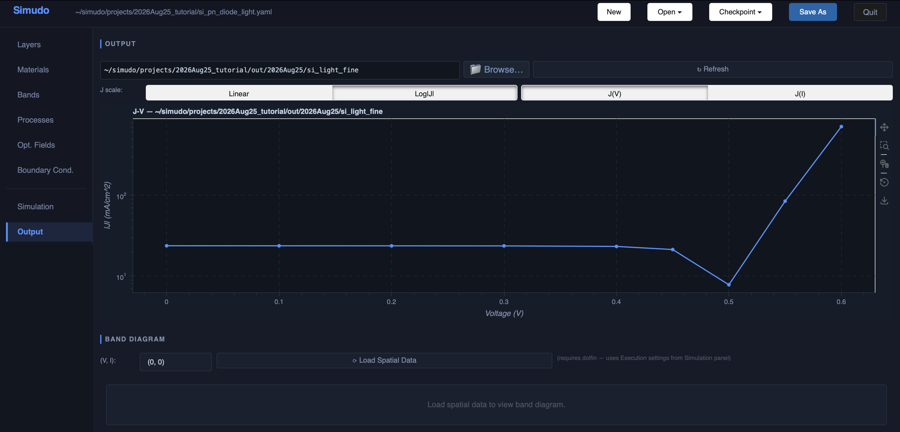

The **Output** panel reads one run at a time. Point it at the illuminated run's
folder and you get the illuminated J–V; point it at the dark run's folder and
you get the dark one. Flipping between the two folders is how you compare them.

The curve now passes through the fourth quadrant: negative current at zero bias
(the device delivers power) crossing zero at the open-circuit voltage. The
figure above uses **Log|J|**, which is the readable scale for this sweep: on a
linear axis the 0.6 V point, at 714 mA/cm², is thirty times the short-circuit
current and flattens everything else onto the zero line. On the log axis the
plateau at 23.8 mA/cm², the dive through open circuit near 0.5 V, and the
exponential above it are all visible at once. Reading off this run:

| | |
|---|---|
| Short-circuit current | ≈ 23.8 mA/cm² |
| Open-circuit voltage | ≈ 0.504 V |
| Fill factor | ≈ 0.80 |
| Efficiency | ≈ 9.6 % |

The first two are visible directly on the plot — J at V = 0, and where the
curve crosses zero.

> **Note:** The 0.6 V point is a free check on the whole calculation. An ideal
> solar cell obeys superposition: the illuminated curve is the dark curve
> shifted down by the photocurrent. Here the dark run gave 737.8 mA/cm² at 0.6
> V and the short-circuit current is 23.8 mA/cm², so superposition predicts
> 714.0 — and the illuminated run gives **714.3**. Agreement to 0.04 % says the
> two runs are describing the same device. It is worth doing on a device you do
> not already trust; where superposition *fails*, the reason is usually
> physical (an injection-dependent lifetime, series resistance) rather than
> numerical.

**A band diagram.** Make sure that you are looking at the illuminated folder.
Below the J–V section, choose a (V,I) point from the dropdown and press **⟳
Load Spatial Data**. I is usually 0 (dark) or 1 (fully illuminated, using the
fields set in the **Opt. Fields** panel.)

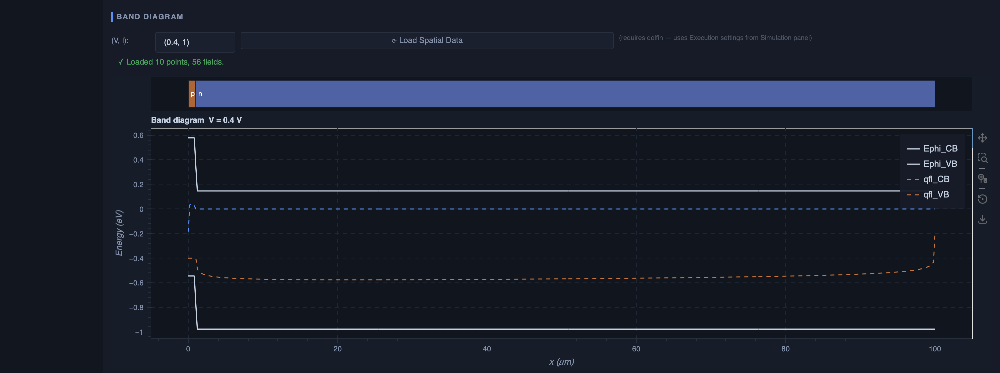
You get the band edges and quasi-Fermi levels across the device at that bias.
The figure shows **(0.4, 1)**. Try (0, 1) as well: at short circuit the bands
are more steeply tilted, and by 0.4 V — most of the way to the 0.504 V open
circuit — the tilt across the base has largely gone and the two quasi-Fermi
levels sit about 0.4 eV apart, flat across the whole 99 µm. Flat quasi-Fermi
levels mean no net driving force: the current at that bias is being carried by
diffusion down a concentration gradient too small to see on this scale.

#### Looking inside the device

The J–V curve says what came out; the **spatial plots** say why.

> **Important:** Note: Spatial plots read the solution fields themselves, not
> the summary CSV, so the run has to have saved them. In the **Simulation**
> panel, under Output, turn on the XDMF mesh output *before* running. Without
> it, **Load Spatial Data** stops with *"No sim_V=\*_full.xdmf or
> sim_I=\*_full.xdmf files found"*. Extraction also needs dolfin, so it runs
> through the execution profile — the same machine that ran the simulation.

In the **Output** panel, scroll to **SPATIAL PLOTS**, press **⟳ Load Spatial
Data**, then **＋ Add Plot**. Each plot takes one or more lines, and each line
picks a quantity and a point in the sweep.

> **Important:** To reproduce the plots shown here, choose the (V, I) point
> **(0, 1)** — zero volts at full illumination. The list is labelled `(V, I)`,
> and `(0, 0)` is the equilibrium starting point, where generation and current
> are both essentially zero and both plots would be essentially flat. For
> spatial plots, you can also choose to display all of the (V,I) curves on the
> same axes.

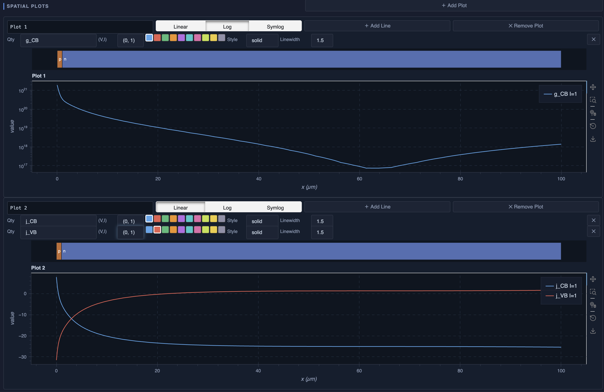

**Plot 1 — generation.** One line, quantity `g_CB`, scale **Log**. This is the
*net* rate at which electrons are generated in the conduction band per unit
volume: optical generation minus recombination. It falls by four orders of
magnitude over the first 60 µm, then turns around and climbs again toward the
back contact.

That turn-around is worth understanding, because it is not a change in the
light. Absorption decays smoothly across the whole device; what changes is how
much of it survives locally. All three rates below are in cm⁻³·s⁻¹:

| Depth | optical generation | SRH recombination | net |
|---|---|---|---|
| 0.5 µm | 6.4e20 | −2.2e16 | 6.4e20 |
| 30 µm | 8.7e18 | −4.8e18 | 3.9e18 |
| 60 µm | 3.0e18 | −3.0e18 | **9.2e16** |
| 99.5 µm | 1.4e18 | −4.3e16 | 1.4e18 |

In the middle of the base, recombination cancels almost everything the light
creates — 97% of it at 60 µm. Right at the back contact the ohmic boundary
holds the carrier densities at their equilibrium values, so there is no excess
to recombine and the net rate returns to the optical rate. You can see both
components separately by plotting `g_opt_cv_CB` and `g_SRH_CB` on the same
axes.

**Plot 2 — components of the current.** Two lines, `j_CB` and `j_VB`, both at
(V, I) = (0, 1), on a linear scale. The hole current is large just past the
junction and decays away; the electron current grows to meet it and then
flattens. Both are current densities in mA/cm²:

| Depth | `j_CB` | `j_VB` |
|---|---|---|
| 1 µm | −4.9 | −18.9 |
| 5 µm | −15.7 | −8.1 |
| 20 µm | −23.4 | −0.4 |
| 50 µm | −25.0 | +1.3 |
| 99 µm | −25.4 | +1.6 |

Both curves are flat beyond about 30 µm. The hole current is essentially zero
deep inside the n-type layer. Minority carriers produced deep inside the device
are not contributing to the current.

Note that `j_tot` is the total current, which is spatially uniform in a 1D
device and equal to the current density shown in the J(V) curves above. It is
only interesting to plot when checking whether simulations have converged.

> **Note:** The GUI's plots are for looking, not for publishing. Anything more
> involved is better done outside it. Two J–V curves can be compared by reading
> the `sim_V.csv` files written with each run — one row per bias point, one
> column per contact and band. Band diagrams and other spatially resolved
> quantities are best handled with the tools in
> `simudo/example/fourlayer/sweep_extraction.py`, which load the XDMF output
> directly and give you the fields as arrays.

#### Absorbing is not collecting

Every photon above silicon's 1.12 eV gap in the AM1.5 spectrum, if collected,
would give 43.8 mA/cm². This cell delivers 23.8 — a little over half — even
though it is thick enough to absorb nearly all of that light.

The two plots explain the gap. The minority-carrier diffusion length in the
base is

$$L = \sqrt{D\tau} = \sqrt{(k T/q)\,\mu_p \tau} \approx 34\ \mu\mathrm{m}$$

for the 1 µs lifetime and silicon's hole mobility. The base is 99 µm deep.
Carriers generated further than a diffusion length from the junction recombine
before they reach it. The cell absorbs the light but cannot collect the holes.

The lifetime that governs it is the one in the **base** — the `n` layer here —
so it is a good exercise to set `SRH/VB/tau` on the `n` layer, as you did for
the `p` layer earlier, and watch Jsc move.

### 1.6 Checkpoints and resuming

Long sweeps are worth checkpointing. In **Simulation**, set the checkpoint
directory and ask for a checkpoint at the end of the voltage sweep.

To continue, use the **Checkpoint** selector at the top of any panel and pick
`sim_V=0.6.yaml`. Choosing that checkpoint reopens the project
inside the run's own output folder, sets **resume from** for you, and leaves
the output folder the same as in the original run. You can extend the voltage list to
include 0.7 and 0.8 V and run again.

Resuming *into the run's own folder* makes this cheap. The runner
skips any bias point already recorded in that folder's `sim_V.csv`, so only
0.7 and 0.8 V are solved and the new rows are appended to the curve you
already have. If you make the output folder somewhere new, the checkpoint still saves
you the intensity ramp, but every bias point below 0.6 V is computed again.

You can also reload from checkpoints by hand: leave the output folder as it is
and set **resume from** on the **Simulation** panel to
`checkpoints/sim_V=0.6.yaml`, relative to that folder.

Either way the log confirms it, printing a line like:

```text
Resuming from checkpoint: V=0.6  (stage=up_v, .../checkpoints/sim_V=0.6.yaml)
```

and then continuing from 0.6 V rather than starting over at zero. The two new
voltage points take about seven seconds. The **Output** panel now lets you
visualize the device under all of the voltages.

---

## Part 2 — An intermediate-band cell with a heterojunction

An intermediate band (IB) is a narrow band inside the standard semiconductor
band gap. A photon too weak to cross the whole gap can promote a carrier from
the valence band to the IB, and a second photon can take it from the IB to the
conduction band. Two sub-gap photons therefore do the work of one above-gap
photon, and the devices in principle can have the voltage from a larger band
gap while still maintaining high current.

Here we demonstrate both IB solar cells and heterojunction devices by making an
artificial IB solar cell from an AlGaAs/GaAs heterojunction. This is not a good
IB cell, just one to demonstrate how to simulate them.

Start a **new project** for this one — File ▸ New, then set a save location as
you did in §1.1. `temperature` is already on `domain` at 300 K.

Go into the **Materials** panel to add the GaAs and AlGaAs materials to the
project. In the **Layers** panel, construct a 3-layer device:

| Layer | Thickness | Material | Doping | Type |
|---|---|---|---|---|
| `p` | 0.5 µm | AlGaAs (x = 0.3) | 1e17 cm⁻³ | p-type |
| `ib` | 2 µm | AlGaAs (x = 0.3) + an IB | 1.25e17 cm⁻³ | n-type |
| `n` | 2 µm | GaAs | 1e17 cm⁻³ | n-type |

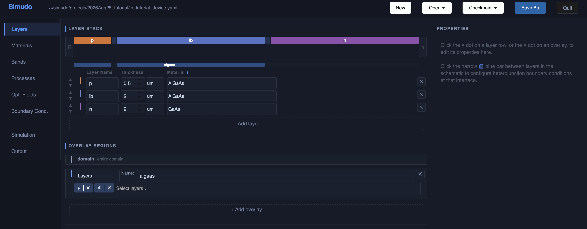

The first two layers are the same alloy, so there is no heterojunction between
them. The `ib | n` interface is a real one: AlGaAs and GaAs differ by 0.29 eV
in the conduction band and 0.10 eV in the valence band.

**The mesh needs attention.** Leave the
maximum spacing (on the **Simulation** panel) at its default **0.02 µm** —
in section §1.4 you raised it to 100 µm for the silicon cell. Here the whole
device is 4.5 µm, so the default is already the right scale.
What matters instead is the *starting*
spacing at each layer's edges. Click each layer's dot on the **Layers** panel, expand
**MESH OPTIONS**, and set **Starting mesh spacing = 1e-5 µm** — the box will
show it as `0.00001` — leaving the expansion factor at **1.2**. Do it for all
three layers.

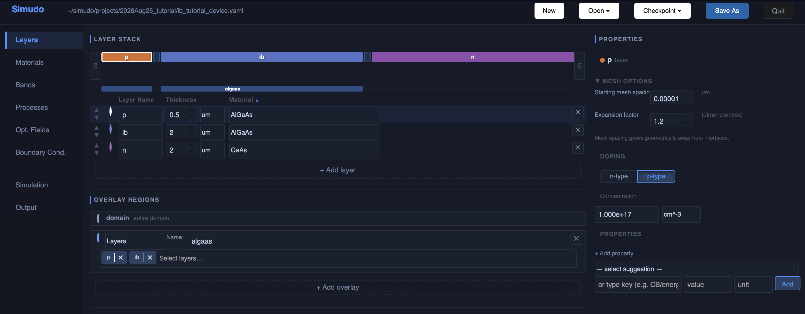

That is five hundred times finer than the 0.005 µm default, and it matters:

| starting spacing | mesh points | Jsc (mA/cm²) | efficiency |
|---|---|---|---|
| 0.005 µm (the default) | 247 | 22.97 | 19.9 % |
| **1e-5 µm** | 424 | **21.40** | **18.5 %** |
| 1e-6 µm | 493 | 21.40 | 18.5 % |

The default overstates the short-circuit current by 7.4 %. Refining a further
decade to 1e-6 changes it by 0.03 %, which is how we know 1e-5 is enough. Voc
and fill factor are barely affected; it is the current that moves. The device
is graded either side of the `ib` layer: a heterojunction at `ib | n` and the
IB's own extent boundary at `p | ib`, and both need to be resolved.


### 2.1 Overlay regions

`AluminumGalliumArsenideAlloy` needs to be told its composition (the aluminum
fraction), and that is a good excuse to meet the third way of specifying a
parameter.

Every parameter so far has been set either device-wide (on `domain`) or on a
single layer. An **overlay region** sits between the two: it spans a chosen set
of layers, and properties set on an overlay region take priority over both
`domain` and layers.

This device has a natural one — the two AlGaAs layers. In the **Layers** panel,
under **Overlay regions**, click **+ Add overlay**, name it `algaas`, and set
its extent to the layers `p` and `ib`. Then click its coloured dot on the left
and add three properties in the Properties pane:

| Property | Value |
|---|---|
| `MoleFractionX` | 0.3 |
| `SRH/CB/tau` | 3e-7 s |
| `SRH/VB/tau` | 3e-7 s |

All three properties now apply across the `p` and `ib` layers together and
nowhere else. The composition is a property of the alloy, so it belongs exactly
where the alloy is; the two lifetimes override what the AlGaAs material
supplies, while the GaAs layer keeps its own material's values.

Overlays are the tidy way to say *this property belongs to this part of the
device*, instead of repeating it layer by layer.

The full priority order is:

```text
named overlay region  >  layer  >  domain  >  material
```

`domain` is an overlay region too, but it is the one that means *everywhere*,
so it sits below layers in priority: it states the default, and anything more specific
overrides it.

### 2.2 The intermediate band

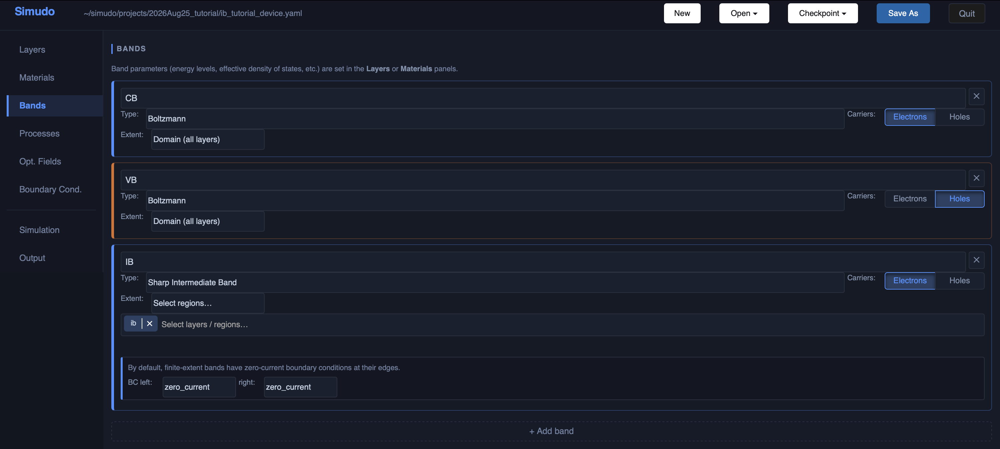

In the **Bands** panel, add a third band:

| Band | Type | Carriers | Extent |
|---|---|---|---|
| `IB` | Sharp Intermediate Band | Electrons | the `ib` layer only |

Choosing anything other than *Domain (all layers)* for the extent opens a
region picker; add the `ib` layer to it. The panel then shows the boundary
conditions at the band's edges, which default to `zero_current` — carriers
cannot leak out of the end of a band that does not exist beyond it.

**The extent matters.** We are going to consider a case where the IB physically
exists only in the middle layer, and setting the extent correctly enforces that
the IB ends.

In the **Layers** panel, on the `ib` layer, set the IB's own parameters:

| Parameter | Value | Unit to type |
|---|---|---|
| `IB/energy_level` | 0.611 | `eV` |
| `IB/number_of_states` | 2.5e17 | `cm^-3` |
| `IB/mobility0` | 500 | `cm^2/V/s` |

Type that last unit exactly as shown — `cm^2/V/s`, with carets, not
superscripts. The GUI suggests a unit for the parameters it recognises, but
`IB/mobility0` is one you type yourself.

`IB/mobility0` is the mobility of the *empty* band. The mobility Simudo
actually uses falls as the band fills, because a carrier needs an empty state
to move into; at half filling it is about a third of `IB/mobility0`.

You already set the `ib` layer's doping to n-type 1.25e17 cm⁻³. That is half
the IB's density of states, which leaves the band **half full** — the condition
where it can both give up and accept carriers.

With these numbers the energy levels in the `ib` layer are:

| | Energy above the valence band |
|---|---|
| CB | 1.826 eV |
| IB | 0.611 eV |
| VB | 0 |

### 2.3 The heterojunction

To configure the interface, in the **Layers** panel, click the narrow blue bar
between `ib` and `n` in the schematic at the top of the Layer Stack panel. Add
a `ThermionicHeterojunction` on both `CB` and `VB`, and leave the enhancement
factor at its default.

The enhancement factor scales how strongly the interface condition is imposed
on the solver. Leave it at 1. On this device raising it changes nothing
measurable — 1e3 and 1e6 give results identical to 1.

### 2.4 Processes


This device needs six processes:

| Name | Class | Lower E | Higher E | Trap |
|---|---|---|---|---|
| `SRH` | SRHRecombination | VB | CB | — |
| `nr_ci` | NonRadiativeTrap | IB | CB | IB |
| `nr_iv` | NonRadiativeTrap | VB | IB | IB |
| `opt_cv` | BeerLambert | VB | CB | — |
| `opt_ci` | IBBeerLambert | IB | CB | IB |
| `opt_iv` | IBBeerLambert | VB | IB | IB |

The two `NonRadiativeTrap` processes are thermal capture and emission between
the IB and each ordinary band. After adding these processes, a yellow dot in
the left sidebar tells you to go back to the Layers panel to set parameters. Go
to the `ib` layer and give `nr_ci` and `nr_iv` cross sections `sigma_th` of
5e-18 cm². The required thermal velocity for those processes comes from the
band, via the material.

The three optical processes need associated optical absorption information. The
GaAs material class provides `opt_cv/alpha_function`, but the alloy class does
not give `alpha(E)` for AlGaAs. We will add top-hat `alpha(E)` in the `algaas`
region and top-hat absorption cross sections `sigma(E)` for the `opt_ci` and
`opt_iv` transitions that include the intermediate band. Energy conservation is
not enforced automatically, but to be physical a transition cannot absorb a
photon with lower energy than its own energy separation. Go into the Processes
panel and press "+ add top-hat region" for each of those optical processes. Use
these thresholds:

| Process | Transition | Threshold | alpha/sigma |
|---|---|---|---|
| `opt_iv` | IB ← VB | 0.611 eV | sigma 3e-14 cm^2 |
| `opt_ci` | CB ← IB | 1.215 eV | sigma 3e-14 cm^2 |
| `opt_cv` | CB ← VB | 1.826 eV | alpha 1e4 cm^-1 |

Add the `opt_ci` and `opt_iv` only to the `ib` region, but add the `opt_cv`
top-hat to both `p` and `ib` regions; currently those have to be done
separately, but we should soon support adding them to the `algaas` overlay
region directly. Note that 0.611 + 1.215 = 1.826: the two sub-gap steps add up
to the host gap, which is required for a sharp (only one energy) IB.

Scroll down the Processes panel and the three optical processes should look
like this:

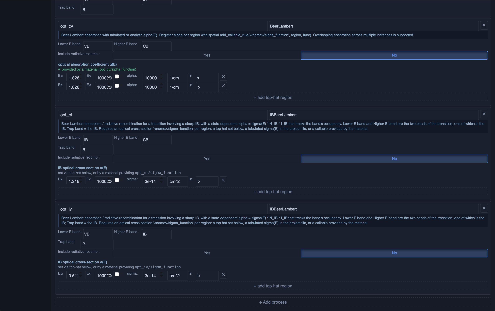

Leave the `E<` boxes unticked, which means the top hat has no upper cutoff.

**Set `Include radiative recomb.` to `No` on all three optical processes.**
§2.5 explains why.

> **Note:** The cross-sections used here — 3e-14 cm² for both IB transitions —
> are rather large. Half filling puts 1.25e17 cm⁻³ into each transition, so
> each one contributes $3 \cdot 10^{-14}\,\mathrm{cm^2} \times 1.25 \cdot
> 10^{17}\,\mathrm{cm^{-3}} = 3750\ \mathrm{cm^{-1}}$, or 0.375 µm⁻¹.
>
> How much light is absorbed therefore depends on the photon energy, because
> the two transitions overlap rather than dividing the spectrum between them:
>
> | Photon energy | Absorbing transitions | Sub-gap α | Absorbed in 2 µm |
> |---|---|---|---|
> | 0.611 – 1.215 eV | `opt_iv` only | 3750 cm⁻¹ | 53 % |
> | 1.215 – 1.826 eV | `opt_iv` and `opt_ci` | 7500 cm⁻¹ | 78 % |
>
> Above 1.826 eV the band-to-band process `opt_cv` joins in as well. Raising
> `IB/number_of_states`, the optical cross-section, or the `ib` layer thickness
> all increase the absorption.

### 2.5 Radiative recombination, and why it is off here

We have just turned radiative recombination off for all three optical
processes, which is *not* the usual recommendation.

Spontaneous emission is always physically present, and Simudo models it with a
Shockley–van Roosbroeck term: every process that absorbs also emits.
Simudo does not model **photon recycling** — a photon emitted inside the
device is gone, rather than potentially being reabsorbed somewhere else. So radiative
recombination here is a pure loss, and the simulated device is pessimistic by
however much recycling a real one would achieve.

For most devices that overestimate is small and you should leave the radiative emission
in. For this one it is not small, due to the large optical cross sections.
With purely lossy radiative emission on, this cell manages about 2%
efficiency; with it off, about 18%. Much of the difference is an
artifact of the missing recycling, so the version worth looking at is the one
with emission off.

**If you did want it on**, the extra step is one parameter: the Shockley–van
Roosbroeck integral needs a refractive index. Set `refractive_index` on the
`domain` region in the **Layers** panel — 3.5 is reasonable for these alloys —
unless your material files already supply it, in which case it is picked up
automatically. Without it the run stops before solving, with a message naming
the process that wanted it.

### 2.6 Light, and the run


In the **Opt. Fields** panel, add an AM1.5g field set again, this time from
**0.611 eV** — the lowest energy anything in this device can absorb — up to 4.0
eV, in 10 bins. Then, in the **Simulation** panel, set the mode to Illuminated
J-V and sweep 0 to 1.0 V — this cell's open-circuit voltage is near 0.98 V.

**Turn on self-consistent optics**, for the intensity ramp and the voltage
sweep both — the checkbox beside each stage in the Simulation panel. Optical
processes through an intermediate band need it. Both `IBBeerLambert` processes
take their absorption from the IB's occupancy — `opt_iv` needs empty states in
the IB to absorb into, `opt_ci` needs filled ones to absorb from — so
absorption depends on the electrical solution and the electrical solution depends
on absorption. With
the box ticked the optical problem is re-solved after every Newton iteration
instead of once per bias point. Device 1's `BeerLambert` had a fixed α(E) from
the material, with nothing to be self-consistent about.

> **Note:** On *this* device it makes almost no difference, and costs almost
> nothing. In this device, IB stays near half filling here, so
> absorption does not change significantly during Newton steps.
> Self-consistency is more important
> when the occupancy really does move: concentrated light, a low-density IB,
> or a cell driven hard enough to bleach the sub-gap transitions.

The Simulation panel should look like this:


This run takes about two minutes on an M2 Mac Mini: three optical
processes over ten spectral bins on a 424-point mesh. It is a
good moment to note that the **execution profile** exists precisely so Simudo
can run on a bigger machine than the one serving the GUI, and that the
checkpoint you asked for at the end of the intensity ramp means a second sweep
— a different voltage list, say — costs seconds rather than repeating the ramp.

#### What you should get

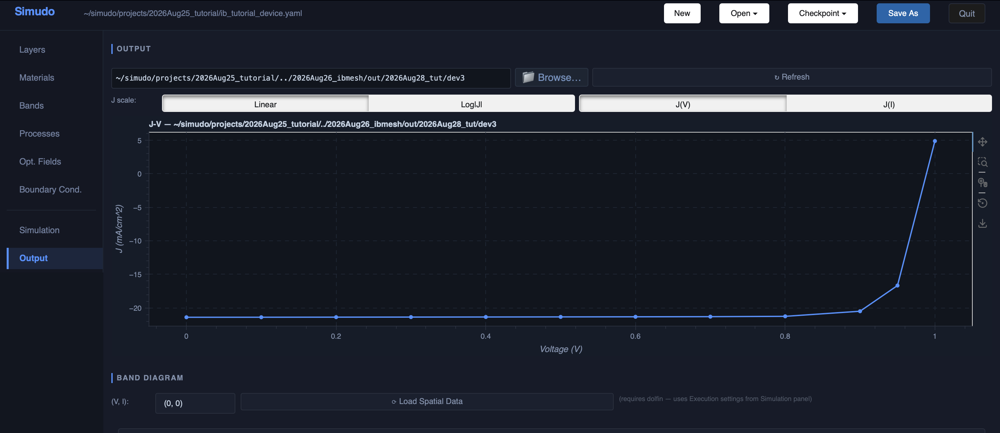

| | |
|---|---|
| Jsc | 21.4 mA/cm² |
| Voc | 0.99 V |
| Fill factor | 0.87 |
| Efficiency | 18.5 % |

Read Voc off the plot with some caution. The curve is exponential where it
crosses zero, so interpolating linearly between the two bracketing points
underestimates it by 10–20 mV. Add points near the crossing if you need more
precision.

#### Things worth trying

The device is built now, so it is cheap to ask it questions. A few that change
the answer in instructive ways:

- **Thin the `ib` layer.** Sub-gap absorption falls with thickness — 53 % of
  the 0.611–1.215 eV window in 2 µm, about 14 % in 0.4 µm — but so does the
  volume in which carriers are captured back into the IB. Which effect wins is
  not obvious in advance.
- **Turn radiative recombination back on**, remembering `refractive_index` from
  §2.5, and watch the efficiency collapse. That is the photon-recycling
  question of §2.5 made concrete.
- **Change `nr_ci/sigma_th` and `nr_iv/sigma_th`.** These set how strongly the
  IB is thermally coupled to the ordinary bands.

---

## Reference

### Where the output goes

Each run writes to the folder named in the **Output** panel. If that folder
already exists, the runner **increments the last character** rather than
overwriting: `out/2026Aug17/a` becomes `out/2026Aug17/b`. This system is
designed to work well if you name output folders like `<project>/out/<date>/a`.

Inside you will find `sim_V.csv` (the J–V curve), a spatial profile per bias
point, the log, a copy of the project (a yaml file that can be reloaded back
into the GUI), and any checkpoints.

### The panels

| Panel | What it holds |
|---|---|
| **Layers** | The layer stack, thicknesses, materials, per-layer and per-region parameters, and the interface editor |
| **Materials** | The material library, and derived materials that override library values |
| **Bands** | Band list: type, carrier sign, extent |
| **Processes** | Recombination and optical processes, and their parameters |
| **Opt. Fields** | Illumination: spectra, energy ranges, bin counts, concentration |
| **Boundary Cond.** | Contact roles and per-band contact conditions |
| **Simulation** | Intensity ramp, voltage sweep, checkpoints, mesh, output, and where the run executes |
| **Output** | J–V curves, band diagrams, and spatial plots from a finished run |

### Process classes

| Class | Use it for |
|---|---|
| `SRHRecombination` | Shockley–Read–Hall through midgap traps, no explicit trap band |
| `NonRadiativeTrap` | Thermal capture/emission between an ordinary band and a sharp IB |
| `ShockleyReadBand2BandTrap` | Shockley–Read-like transfer between two dispersing bands |
| `ShockleyReadTrap2Trap` | Transfer between two sharp trap bands |
| `BeerLambert` | Absorption between two ordinary bands, arbitrary α(E) |
| `IBBeerLambert` | Absorption involving a sharp IB, where α follows the band's filling |
| `NonOverlappingTopHatBeerLambert` | As `BeerLambert`, assuming constant α(E) and that only one process absorbs each photon energy |
| `NonOverlappingTopHatBeerLambertIB` | The IB version of the same |
| `StaticGeneration` | Not usable from the GUI — see its hint in the Processes panel |

Selecting a class in the **Processes** panel shows a short usage note beneath
the selector.
