# Simudo GUI Tutorial

This tutorial walks through every panel of the Simudo graphical user interface.
The GUI lets you build a 1D semiconductor device simulation, configure all
physics, and launch a run — without writing Python or editing YAML by hand.

Screenshots in this document were captured from the `fourlayer_ibBeerLambert`
example, which contains an intermediate band and three optical processes.
Most of the features described here apply to any simulation type.

---

## Table of Contents

1. [Launching the GUI](#1-launching-the-gui)
2. [The main window](#2-the-main-window)
3. [Opening and saving projects](#3-opening-and-saving-projects)
4. [Layers panel](#4-layers-panel)
5. [Materials panel](#5-materials-panel)
6. [Bands panel](#6-bands-panel)
7. [Processes panel](#7-processes-panel)
8. [Optical Fields panel](#8-optical-fields-panel)
9. [Boundary Conditions panel](#9-boundary-conditions-panel)
10. [Simulation panel](#10-simulation-panel)
11. [Output panel](#11-output-panel)
12. [Typical workflow](#12-typical-workflow)
13. [Walkthrough — building a p/IB/n solar cell from scratch](#13-walkthrough--building-a-pibn-solar-cell-from-scratch)

---

## 1. Launching the GUI

These instructions assume you have already installed Simudo and its GUI
following the [installation guide](../doc/source/user/install.rst).

1. Open a terminal.
2. Activate the `simudo_gui` conda environment:
   ```bash
   conda activate simudo_gui
   ```
3. Go to the `gui/` folder inside your Simudo installation:
   ```bash
   cd /path/to/simudo/gui
   ```
4. Start the GUI:
   ```bash
   panel serve app.py --show --port 5006
   ```
   The `--show` flag should open a browser tab automatically at
   `http://localhost:5006/app`.  If it does not, open that address yourself.

> **Tip — keep your project files in their own folder.**
> When you save a project, put it somewhere *outside* the Simudo installation —
> for example `~/simudo_projects/my_device.yaml`.  That way your files are
> easy to back up, and they will not be affected if you update or reinstall
> Simudo later.

---

## 2. The main window

The GUI is divided into three regions:

| Region | Description |
|--------|-------------|
| **Top toolbar** | Application title, file path of the open project, and **New / Open / Save As / Quit** buttons |
| **Left sidebar** | Navigation buttons for each panel, separated into *Device* (Layers → Boundary Cond.) and *Run* (Simulation, Output) sections |
| **Main area** | Content for the currently selected panel |

On the very first launch, the GUI automatically loads a built-in example
project (`fourlayer_ibBeerLambert.yaml`) so you can explore straight away
without starting from scratch.  On subsequent launches it reopens whatever
project you had open last.

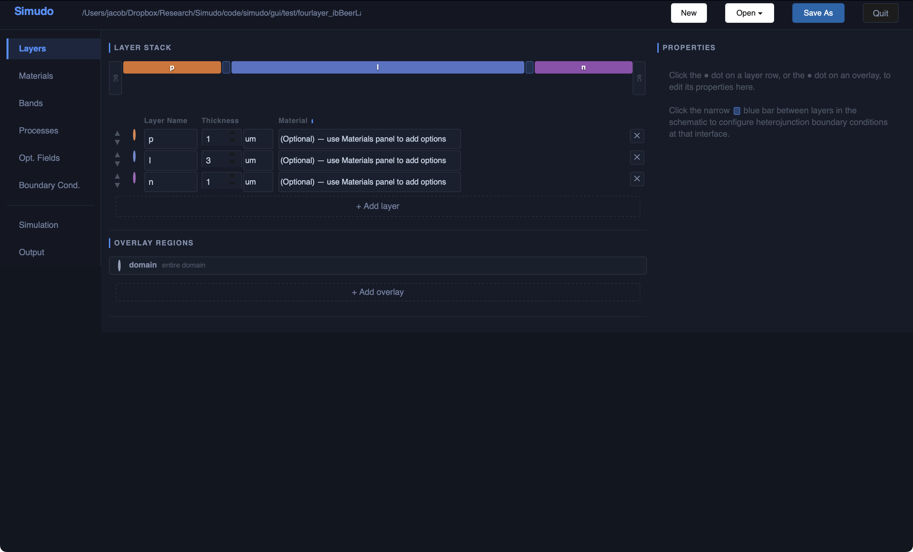

---

## 3. Opening and saving projects

Projects are stored as YAML files.  Use the top toolbar to manage them.

### Opening a file

Click **Open ▾** to reveal the dropdown:

- **Open file…** — intended to open a file-picker dialog, but note that on
  some platforms the system dialog may not appear.  If it does not open, type
  or paste the full file path directly into the toolbar text field and press
  **Enter** to load it.
- **Recent files** — shows the most recently opened paths for quick access.
- **New project** — discards the current project and starts with a blank,
  empty project (no layers).

### Saving

- **Save As** — intended to open a save dialog.  If the system dialog does not
  appear, type the full destination path (e.g. `~/simudo_projects/my_device.yaml`)
  directly into the toolbar text field and press **Enter**, then click
  **Save As** to write the file.
- The GUI also **auto-saves** in place whenever you change a field, so your
  edits are never lost between explicit saves.

### The file path display

The path shown in the toolbar is editable.  You can type or paste a path
directly and press Enter to load that file.

---

## 4. Layers panel


The Layers panel defines the physical structure of the 1D device.

### Layer stack schematic

The coloured bar at the top is a schematic of the device.  Each layer gets a
distinct colour.  The widths are proportional to the layer thicknesses (there
is a minimum width so very thin layers remain visible).
A narrow blue divider between two layers can be clicked to configure
heterojunction interface boundary conditions at that interface.

### Layer table

Below the schematic is a table with one row per layer:

| Column | Description |
|--------|-------------|
| **↑ / ↓ arrows** | Reorder layers (left contact is left, right contact is right) |
| **Colour dot** | Click to open the Properties pane for that layer (see below) |
| **Layer Name** | Editable text field |
| **Thickness** | Numeric value + unit selector |
| **Material** | Optional — assign a material from the Materials library |
| **✕** | Delete this layer |

Click **+ Add layer** at the bottom of the table to append a new layer.

### Overlay regions

Overlay regions span one or more layers and allow you to override properties in a
sub- or super-region.  The built-in **domain**
region covers the entire device and is always present.

Click **+ Add overlay** to create an additional overlay, then click its
colour dot to edit its extent and properties.

> **Note:** The GUI shows an option to define overlay extents by explicit
> x-coordinates, but this feature is not yet implemented in the runner.
> Define extents by selecting layers instead.

### Properties pane

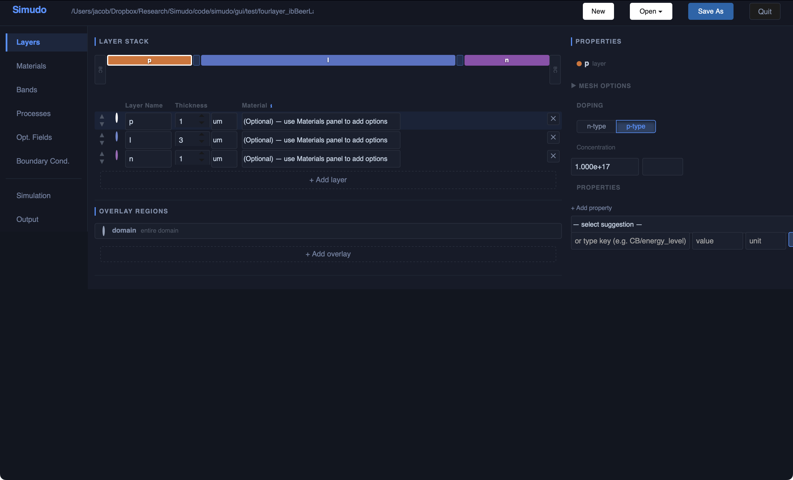

Clicking the colour dot on any layer or overlay region opens the Properties pane
on the right side of the screen.  It shows:

- **Selected layer/region name**
- **Mesh options** (collapsed by default) — `start` spacing and growth
  `factor` for that layer's mesh. To make a finer mesh, decrease the initial mesh spacing or the mesh expansion factor
- **Doping** To model fully ionized dopants, choose whether the region should be toggle **n-type**  or **p-type** and enter a
  concentration. You can use scientific notation like `1e17` the default units
  are `cm^-3`, but you can change those.
- **Properties** — a searchable list of every spatial parameter that can be
  set on this region.  Use the **select suggestion** dropdown to pick from
  known parameters (e.g. `CB/energy_level`, `VB/mobility`), or type a key
  directly.  Each entry has a value field and a unit field.

#### Property priorities
- Parameters set by a material file (see next section) have low priority, 
so anything in the Property editor overrides those defaults.
- Parameters set in the `domain` region have lower priority than
those set in either a layer or another overlay region.
- Parameters set in a `layer` have lower priority than those in overlay regions.

This system allows you, for example, to have materials files that define 
quantities like `CB/energy_level` in all of the layers, and to give SRH 
lifetimes `SRH/CB/tau` and `SRH/VB/tau` in the `domain`, but if you have a 
degraded region (perhaps the union of two layers), you can override `SRH/CB/tau` in that region.

---

## 5. Materials panel

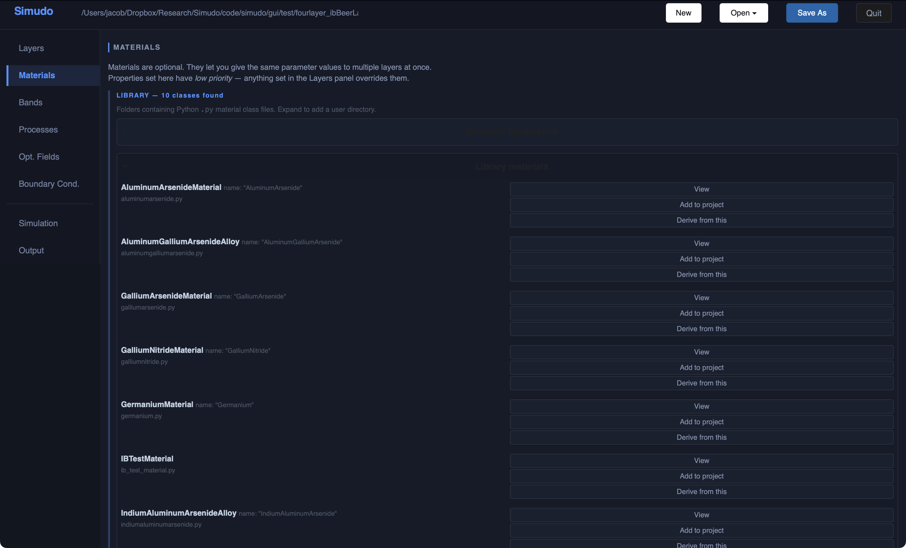

Materials are Python classes that provide default values for all spatial
parameters of a real semiconductor (band gaps, effective masses, mobilities,
etc.).  Applying a material to a layer is optional but convenient — any
parameter you set explicitly in the Layers panel overrides the material value. 
Some default material files are included with Simudo, and you can make your
own material files, following their model.

### Library

The **LIBRARY** section lists every material class found in the configured
search directories.  For each class the panel shows:

- Full class name and short `name=` alias
- Source file path
- **View** — opens the source file to inspect all defined parameters
- **Add to project** — Puts this material into your project, so you can select 
it on the Layers panel. You can also override parameters, if you want to.
- **Derive from this** — creates a new project material that inherits all
  parameters from this class and lets you override individual values

### Search path

The text field at the top of the LIBRARY section shows the folders being
scanned for `.py` material class files.  Add a directory path here to include
your own custom material files.

### Project materials

Materials you have added or derived appear in the **PROJECT** section above
the library.  Assign them to layers in the Layers panel via the Material
column.

---

## 6. Bands panel

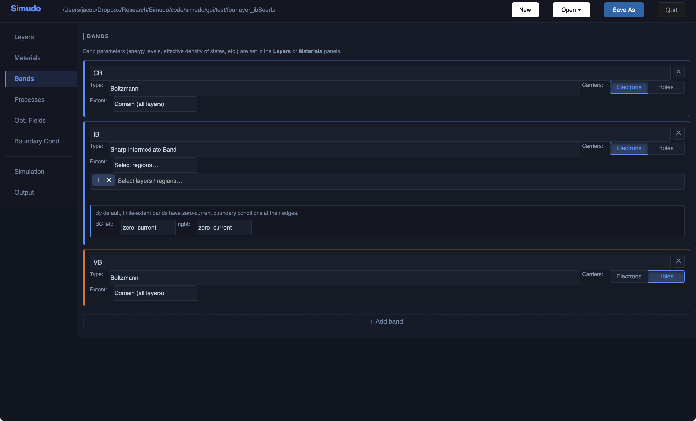

The Bands panel defines the carrier bands that participate in transport.  A
typical semiconductor has a conduction band (CB) and a valence band (VB); an
intermediate-band device adds a third band (IB) while a metal has only one band. Define here all of the bands that appear at any point in the device.

### Band cards

Each band is shown as a card with:

| Field | Description |
|-------|-------------|
| **Name** | If using materials files, these should be chosen to match the parameters in that file.  (e.g. `CB`, `VB`, `IB`) |
| **Type** | Statistical model — **Boltzmann** (standard non-degenerate), **Degenerate** (full Fermi–Dirac, only for parabolic bands, using Joyce-Dixon form), **Sharp Intermediate Band** (IB with one energy level)
| **Carriers** | **Electrons** Which type of carrier is tracked in this band (negative charge, sign = −1) or **Holes** (positive charge, sign = +1).  |
| **Extent** | **Domain (all layers)** — band exists everywhere; or **Select regions…** — band is confined to specific layers or overlay regions |

### Finite-extent bands

When extent is set to *Select regions…* an additional section appears:

- A **MultiChoice** widget to pick the layers/regions the band occupies
- **BC left / BC right** — boundary conditions at the edges of the band's
  extent (default: `zero_current`; can also be `ohmic`)

### Band parameters

Energy levels, effective densities of states, mobilities, and other band
parameters are *not* set here.  Set them in the **Layers** panel (per-region)
or via a **Material** (global defaults).  The Bands panel only defines which bands exist and where.

Click **+ Add band** to add another band. 

---

## 7. Processes panel

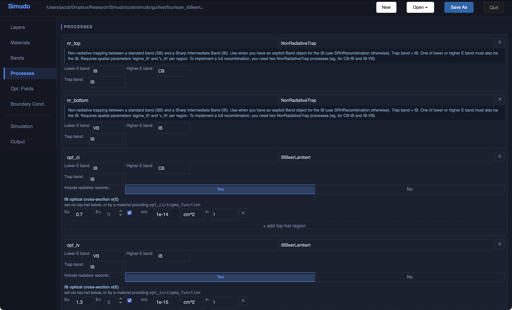

The Processes panel defines the physical mechanisms that couple bands, such as
optical absorption/emission and non-radiative recombination.

### Process cards

Each process moves carriers between two bands. A process card shows:

| Field | Description |
|-------|-------------|
| **Name** | Unique identifier used in parameter keys (e.g. `nr_top`, `opt_ci`) |
| **Class** | The `ElectroOpticalProcess` subclass that implements the physics (see below) |
| **Lower E band** | The band with lower energy (called the "source band" in Simudo) |
| **Higher E band** | The band with higher energy (called the "destination band" in Simudo) |
| **Trap band** | *(trap classes only)* The band that acts as the trap state. Right now, only the sharp IB. |
| **Include radiative recomb.** | *(optical classes only)* Whether radiative recombination is included |

A red warning appears if a duplicate process name is entered, or if the trap
band is not a Sharp Intermediate Band.

### Process classes

The GUI finds all processes that are in the simudo codebase. Currently, those are 
| Nonradiative Classes | Physics |
|-------|---------|
| `SRHRecombination` | Shockley–Read–Hall recombination  |
| `NonRadiativeTrap` | Non-radiative capture/emission from a band to an IB trap|
| `ShockleyReadBand2BandTrap` | SR-like carrier transfer between two bands. Like `NonRadiativeTrap` for an IB that is not sharp. |
| `ShockleyReadTrap2Trap` | Like `NonRadiativeTrap` but connecting two trap bands|

| Optical Classes | Physics |
|-------|---------|
| `BeerLambert` | Beer–Lambert optical absorption between two standard bands; absorption coefficient α(E) or cross-section σ_opt provided as a callable (e.g. from a material file) or as a piecewise top-hat function |
| `IBBeerLambert` | Like `BeerLambert`, but for an optical process involving a sharp intermediate band |
| `NonOverlappingTopHatBeerLambert` | Beer–Lambert optical absorption between two standard bands, assuming α(E) is constant with energy in the allowed energetic regions *and* that only one optical process can absorb each photon energy |
| `NonOverlappingTopHatBeerLambertIB` | Like `NonOverlappingTopHatBeerLambert`, but for an optical process between a sharp IB and a standard band |

When you add a process and the bands it connects, the Layers panel will show any parameters that must be defined for that process. 
*Warning:* The GUI does not check that the parameter is defined everywhere in the device. If you set a parameter in a single layer/region, it will disappear from the "Unset Parameters" list, but it will default to `0` in any region where it is not set. Be sure to set parameters in all regions where they are required.


### Top-hat callable editor

For optical classes `BeerLambert` and `IBBeerLambert`, the absorption coefficient `alpha` or cross-section
`sigma_opt` is a function of energy. They can be set using material files 
with full dependence on spectra. 
They can also be defined as piecewise-constant (top-hat) functions of
photon energy, set directly in the GUI:

- Each row defines one top-hat: energy range **E≥ … E<**, value, unit, and
  the region it applies to
- The **∞** checkbox (defaults to on) makes the upper energy limit infinity
- Click **+ add top-hat region** to add another energy bin
- If a loaded material already provides the callable key for this process, a
  green **✓ provided by a material** note appears and no manual entry is
  needed

---

## 8. Optical Fields panel

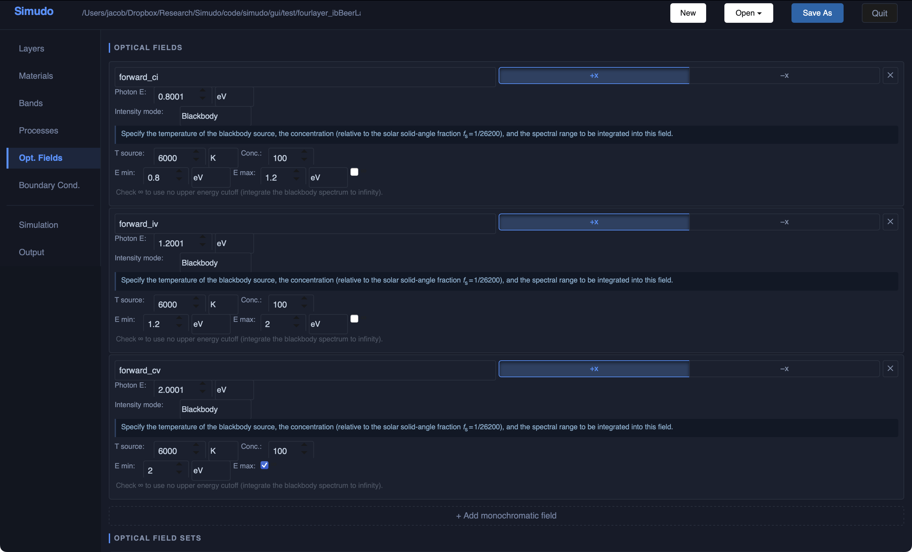

The Optical Fields panel defines the incident illumination.  Each optical
field is a quasi-monochromatic beam characterised by a single photon energy
and an intensity.

### Monochromatic field cards

| Field | Description |
|-------|-------------|
| **Name** | Identifier used in output files (e.g. `forward_ci`) |
| **Direction** | **+x** (incident from the left) or **−x** (incident from the right) |
| **Photon energy** | Value + unit (eV, nm, μm, cm⁻¹, or J) |
| **Intensity mode** | **Explicit** (photon flux or power density) or **Blackbody** (integrated over a spectral band) |

#### Explicit intensity mode

Enter a photon flux (cm⁻²s⁻¹) or a power density (mW/cm², W/m², suns, etc.).
A live preview of the photon flux equivalent is shown below the inputs.

#### Blackbody intensity mode

Integrates the Planck spectrum of a source at temperature **T source** over
the energy range **E min … E max**, scaled by a **concentration** factor
relative to the solar solid-angle fraction (1/46200).  Tick the **∞**
checkbox to integrate to infinite energy (no upper cutoff).

> **Example:** 100× concentrated AM1.5-equivalent blackbody at 6000 K with
> E min = 0.8 eV and E max = 1.2 eV represents the photons available for
> IB→CB transitions.

Click **+ Add monochromatic field** to add another field.

### Optical field sets

Defining every photon energy by hand works well for one or two narrow spectral
lines, but solar illumination spans a continuous spectrum with hundreds of
relevant energies.  The **OPTICAL FIELD SETS** section solves this: you
describe the spectrum once and Simudo automatically creates the individual
monochromatic fields at run time.

Each field set is defined by:

| Field | Description |
|-------|-------------|
| **Name prefix** | Base name for the generated fields, e.g. `sun` |
| **Direction** | **+x** (from the left) or **−x** (from the right) |
| **Spectrum** | `am15g` (AM 1.5 Global), `am15d` (AM 1.5 Direct), or `blackbody` |
| **T source** | *(Blackbody only)* Temperature of the emitting body (e.g. 6000 K) |
| **N bins** | Number of monochromatic fields to generate |
| **Conc.** | Concentration factor — multiplies the spectrum intensity (1 = one-sun equivalent for AM1.5) |
| **Edges** | `equal_flux` — each bin carries the same photon flux; `uniform_energy` — bins are evenly spaced in energy |
| **E min / E max** | Energy range to bin; set E max to 0 to include photons up to infinite energy |

At run time, Simudo divides the chosen spectrum between E min and E max into
**N** energy bins and creates one monochromatic field per bin.  The fields are
named `{prefix}_000`, `{prefix}_001`, …, `{prefix}_{N-1}`.  Each generated
field participates in absorption and recombination processes exactly like a
hand-defined monochromatic field.

Click **+ Add field set (spectrum)** to add a field set.

---

## 9. Boundary Conditions panel

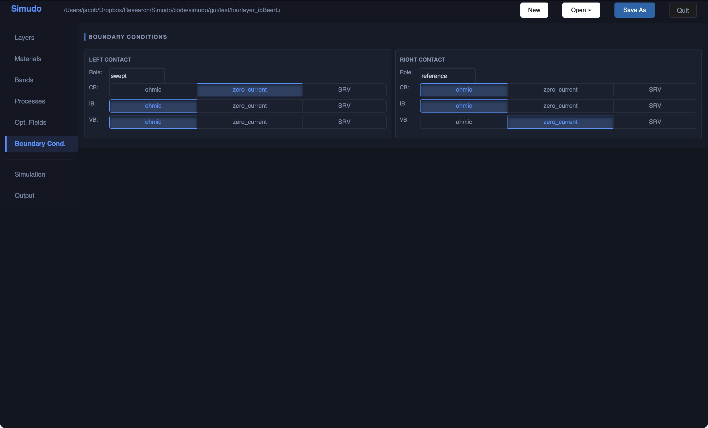

The Boundary Conditions panel sets the electrical contacts at the left and
right edges of the device.

### Contact role

Each contact has a **Role**:

| Role | Meaning |
|------|---------|
| `swept` | The voltage applied here is swept during a J-V calculation |
| `reference` | This contact is held at zero potential (the reference electrode) |

### Per-band boundary conditions

For each carrier band defined in the Bands panel, you can independently
choose:

| BC type | Meaning |
|---------|---------|
| `ohmic` | Carrier density pinned to its equilibrium value (ideal ohmic contact) |
| `zero_current` | No carrier current flows through this contact for this band |
| `SRV` | Surface recombination velocity — a finite recombination rate at the contact surface; enter a value and unit (cm/s or m/s) |


---

## 10. Simulation panel

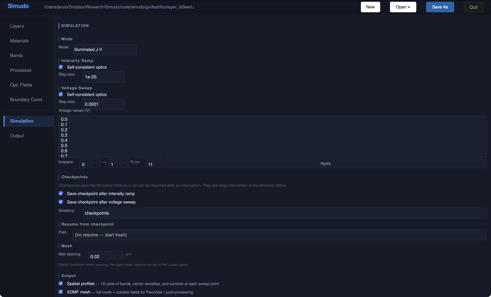

The Simulation panel controls the numerical solver and launches the run.

### Mode

The **Mode** selector chooses which solver stages are executed:

| Mode | Intensity ramp | Voltage sweep |
|------|---------------|---------------|
| Equilibrium only | off | off |
| Dark J-V | off | on |
| Illuminated (V=0) | on | off |
| Illuminated J-V | on | on |

### Intensity ramp

When illumination is enabled, the solver ramps the optical generation from
zero up to the target intensity before sweeping voltage.  Options:

- **Self-consistent optics** — recompute the photon populations at each
  Newton step (slower but required when carrier densities significantly affect
  absorption)
- **Step size** — initial step size for the intensity ramp continuation solver

### Voltage sweep

- **Self-consistent optics** — same as above, applied during the voltage sweep
- **Step size** — initial continuation step size in volts
- **Voltage values (V)** — explicit list of bias points; edit directly or use
  the **linspace** helper (start → end, N points, **Apply**) to generate a
  uniform grid

### Checkpoints

Checkpoints save the full solver state so a run can be resumed after an
interruption.  They are large files written to the **Directory** path.

- **Save checkpoint after intensity ramp** — writes a checkpoint at the end
  of the ramp stage
- **Save checkpoint after voltage sweep** — writes a checkpoint at each
  voltage sweep end point

### Resume from checkpoint

Enter the path to a previously saved checkpoint file.  Leave as
`no resume — start fresh` to begin from equilibrium.

### Mesh

**Max spacing** sets the global maximum mesh edge length (in μm).  Per-layer
mesh parameters (start spacing and growth factor) are set in the **Layers**
panel under each layer's Mesh options.

### Output

- **Spatial profiles** — write CSV files with band energies, carrier
  densities, and currents on a line-cut at each voltage point
- **XDMF mesh** — write the full FEniCS mesh and solution fields in XDMF
  format for post-processing in ParaView

The **Output folder** at the bottom of the Simulation panel sets where all
output files are written.

### Execution profile

The **Execution** card (collapsible, in the lower part of the panel)
configures *where* the solver runs.  Choose a **Type**:

- **Local subprocess** — runs the solver directly on the same machine as the
  GUI.  Requires dolfin and Simudo to be installed locally.
- **Docker (local container)** — runs inside a named Docker container.
  Provide the **Container** name, the **Host root** directory that is
  bind-mounted into the container, and the corresponding **Container root**
  path inside the container.
- **Remote SSH** — sends the project to a remote machine, runs the solver
  there, then syncs the results back.  Provide the **Host**, optional
  **User**, an **Identity file** for key-based authentication, a
  **Remote work dir**, and the path to the Simudo installation on the remote
  machine (**Simudo path**).

All types share a **Python** command field (default `python3`) that is used
to invoke the runner.

Click **Test connection** to verify the backend is reachable.  Click
**Set as default** to save the current settings as the default for all
projects.  Click **Restore default** to revert to the saved default.

### Parameter sweep

The **Parameter Sweep** card (collapsible, below the Execution card) lets you
run the same simulation across a grid of parameter values without leaving the
GUI.  Add one or more parameters to vary, enter a list of values for each,
choose **All combinations (Cartesian product)** or **Pair up variations (zip)**
mode, set the maximum number of parallel runs, and click **▶▶  Run Sweep**.
Results land in numbered sub-directories under the output folder and can be
opened directly in the Output panel via the **▶ Open** buttons in the status
table.

### Running

Once everything is configured, click the green **▶  Run Simulation** button.
Solver output is streamed into the log area in real time.  Click
**■  Interrupt** to abort a running simulation.  After the run finishes, you
can click **📄 View info.log** to inspect the detailed solver log.

---

## 11. Output panel

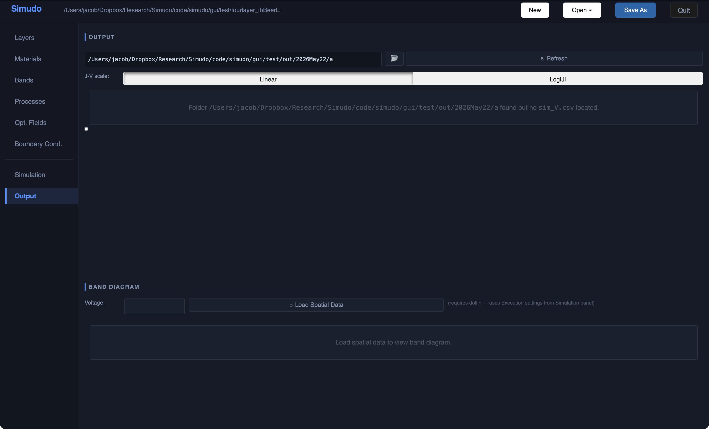

The Output panel displays results from completed simulations.

### Output folder

The path field at the top shows the current output folder (shared with the
Simulation panel).  Type a path directly into the field to point at a
different directory.  Click the **📂** button to reveal the folder in your
file manager, or click **↻ Refresh** to re-scan for new result files.

### J-V curve

When a simulation has completed, the J-V plot appears automatically.  Toggle
between **Linear** and **Log|J|** scales with the buttons above the plot.
The Bokeh plot is interactive — zoom with scroll, pan by dragging, and reset
with the toolbar.

### Band diagram

Select a voltage from the **Voltage** dropdown and click **⟳ Load Spatial Data**
to extract band energies and quasi-Fermi levels from the simulation output
(this calls into the execution environment where dolfin is installed).  The
resulting band diagram shows:

- **Solid black lines** — electrostatic potential energy levels (Ephi) for
  each band
- **Dashed coloured lines** — quasi-Fermi levels (qfl) for each band

A layer schematic above the band diagram shares the same x-axis so that
pan/zoom keeps the layer boundaries aligned with the data.

### Spatial plots

Below the band diagram is a **SPATIAL PLOTS** section.  Click
**＋ Add Plot** to create a custom plot of any spatial quantity from the
simulation output.  Each plot has a title, a scale selector
(Linear / Log / Symlog), and one or more lines defined by choosing a quantity
from the available columns and optionally filtering by voltage.  Plots can be
removed individually with **✕ Remove Plot**.

---

## 12. Typical workflow

Here is a suggested order of operations for setting up a new simulation from
scratch:

1. **File → New project** (or open an existing YAML as a starting point)
2. **Layers** — add layers, set thicknesses and names; set doping via the
   Properties pane
3. **Materials** *(optional)* — assign a semiconductor material to each layer
   to get physical defaults for band parameters
4. **Bands** — confirm CB and VB are present; add IB if needed and set its
   extent to the appropriate layer(s)
5. **Processes** — add recombination and optical processes; set `sigma_th` /
   `v_th` in the Layers panel for trap processes; set `alpha` / `sigma_opt`
   top-hats for optical processes (or rely on a material that provides them)
6. **Optical Fields** — add one field per optical transition; match the photon
   energy to the spectral range of each process
7. **Boundary Cond.** — set the contact roles and per-band BCs
8. **Simulation** — choose the mode, set the voltage points, configure the
   execution backend
9. **Save As** — save to your project directory (outside the Simudo installation folder)
10. Click **▶  Run Simulation** and monitor progress in the log
11. **Output** — view the J-V curve and band diagrams once the run completes

---

## 13. Walkthrough — building a p/IB/n solar cell from scratch

This section shows every step needed to set up the three-layer intermediate-band
solar cell that ships as the `fourlayer_ibBeerLambert` example.  Each stage
corresponds to a pre-generated YAML snapshot in `notes/walkthrough_yamls/`.

### Stage 1 — blank new project

Click **New** (top-left toolbar) to start with an empty project.  The Layers
panel shows *"No layers yet."*  A domain overlay is always present; it holds
global parameters such as temperature.

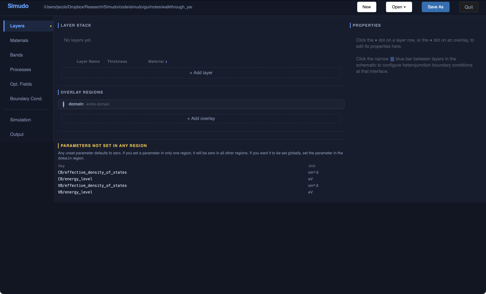

The **PARAMETERS NOT SET IN ANY REGION** section at the bottom lists properties
required by the currently configured bands (CB and VB by default) that have not
yet been given values.  This list shortens as you fill in parameters.

---

### Stage 2 — three layers added

Click **+ Add layer** three times and name the layers **p**, **I**, and **n**.
Set each thickness in the table (1 µm / 3 µm / 1 µm here).

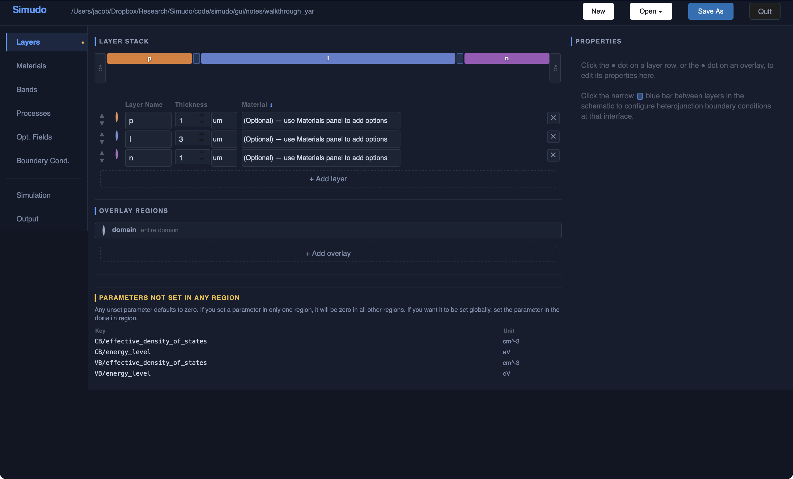

The coloured **Layer Stack** schematic at the top updates immediately.  Layers
are ordered left-to-right in the schematic (p at the illuminated face).

---

### Stage 3 — layer properties and interface BCs

Click the narrow coloured bar *between* two layers in the schematic to open the
**interface boundary condition** settings in the Properties pane on the right.
This is where you configure thermionic emission enhancements for
heterojunctions.

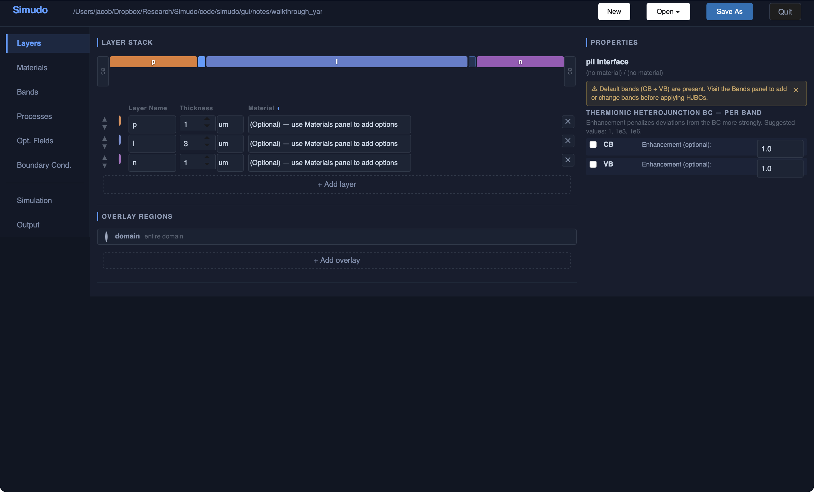

Click the coloured **●** dot at the left of any layer row to open that layer's
properties — doping (`poisson/static_rho`), IB state density
(`IB/number_of_states`), surface-recombination velocities, and any other
per-layer parameter override.

Click the **●** dot of the *domain* overlay (in the **Overlay Regions** section
below the table) to set global properties such as temperature, band energy
levels, effective density of states, mobilities, and permittivity.

---

### Stage 4 — bands configured

Open the **Bands** panel.  The project starts with CB and VB; click
**+ Add band** and choose *Sharp Intermediate Band* to add IB.

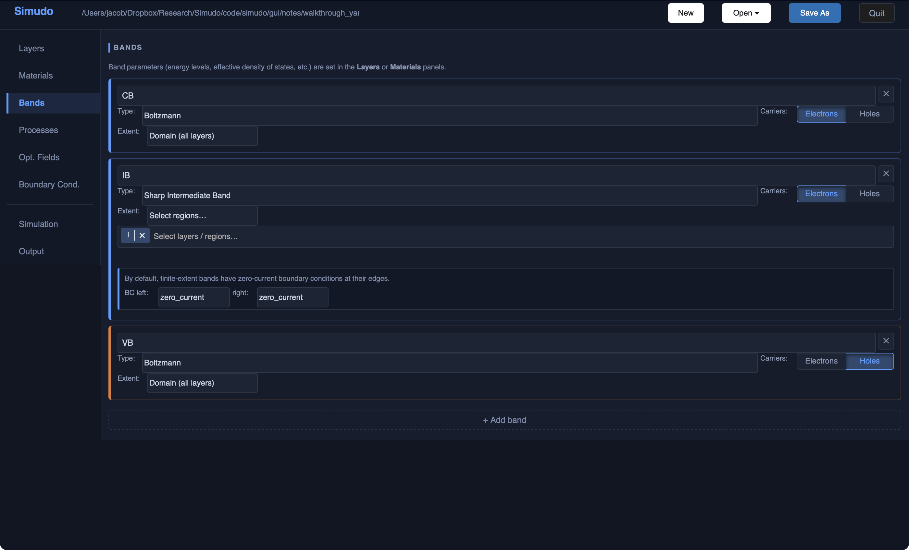

Set the IB **Extent** to the layer(s) where the IB material is present (here,
just layer **I**).  By default, finite-extent bands have zero-current BCs at
their edges; adjust *BC left* / *BC right* if needed.

---

### Stage 5 — optical and trap processes

Open the **Processes** panel and click **+ Add process** to add:

* Two **NonRadiativeTrap** processes — one for CB↔IB (`nr_top`) and one for
  IB↔VB (`nr_bottom`).  Both use the IB as the trap band.
* One **NonOverlappingTopHatBeerLambert** process (`opt_cv`) for the main VB→CB
  optical transition, with *Include radiative recombination* enabled.

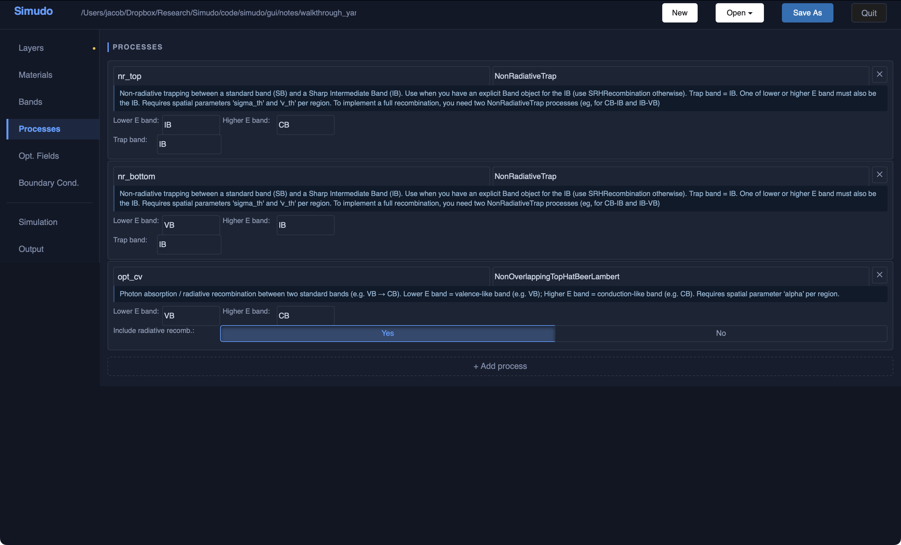

Return to the **Layers** panel to set the spatial parameters that each process
requires (cross-sections `sigma_th` / `v_th` for trap processes; absorption
coefficients `alpha` or `sigma_opt` for optical processes).

---

### Stage 6 — optical field

Open the **Opt. Fields** panel and click **+ Add monochromatic field**.

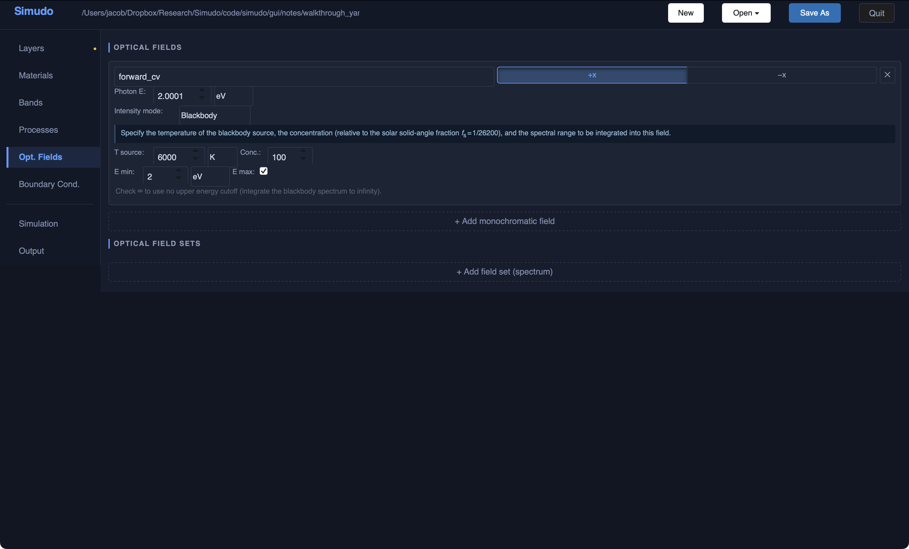

Set the photon energy (here 2.0001 eV, just above the CB–VB gap) and choose
*Blackbody* intensity with T = 6000 K, concentration = 100 suns, E_min = 2 eV,
no upper cutoff.  Each optical process consumes the field whose photon energy
falls within its top-hat absorption window.

---

### Stage 7 — boundary conditions

Open the **Boundary Cond.** panel.  Assign roles and per-band BCs to the two
contacts.

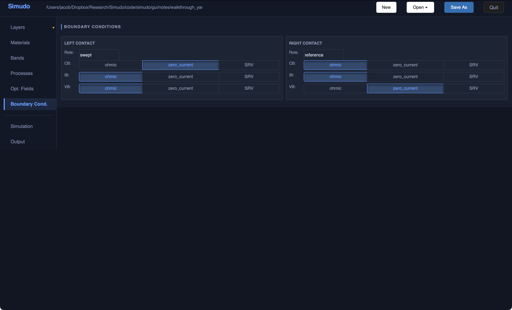

A typical J-V sweep for an IB cell uses:

| Contact | Role | CB | IB | VB |
|---------|------|----|----|-----|
| Left (illuminated) | swept | zero_current | ohmic | ohmic |
| Right | reference | ohmic | ohmic | zero_current |

The *swept* contact is the one whose quasi-Fermi level is swept over the voltage
range; the *reference* contact defines zero voltage.

---

### Stage 8 — simulation settings

Open the **Simulation** panel and configure the run.

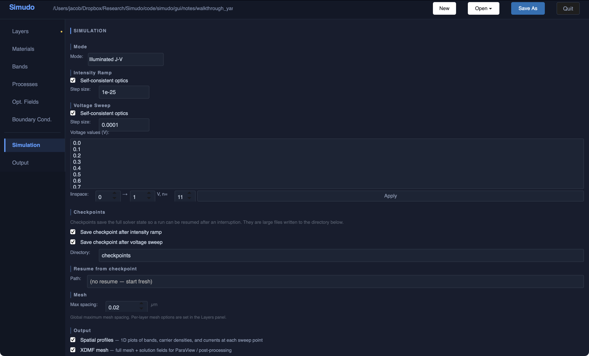

Key settings:

* **Mode** — *Illuminated J-V* runs an intensity ramp followed by a voltage sweep.
* **Intensity Ramp** — enable self-consistent optics; choose a small initial
  step size (e.g. 1 × 10⁻²⁵).
* **Voltage Sweep** — enable self-consistent optics; set *Step size* and list
  the voltage values (0.0 → 1.5 V in 0.1 V steps for this cell).
* **Checkpoints** — saving at the end of each stage lets you resume an
  interrupted run.
* **Output** — enable *Spatial profiles* and *XDMF mesh* for post-processing.
* **Mesh** — set *Max spacing* (0.02 µm here) in the Layers panel if you need
  finer resolution near junctions.

Click **Save As** to write the project to your working directory, then click
**▶  Run Simulation** to launch the simulation via the configured execution backend.

---

*For questions or bug reports, contact [jkrich@uottawa.ca](mailto:jkrich@uottawa.ca).*
